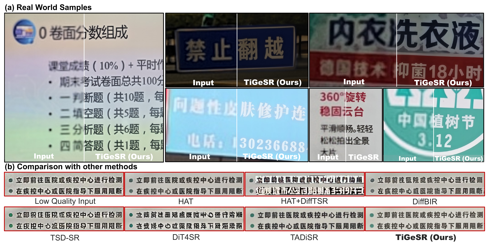
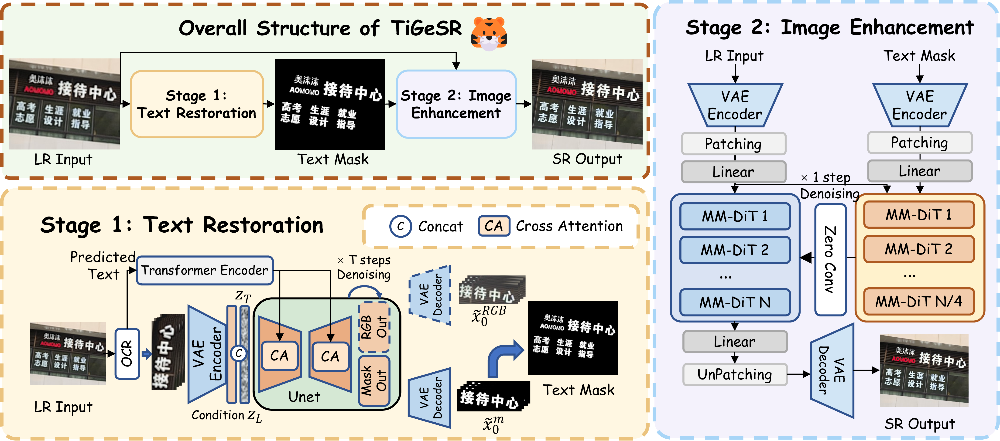

# TiGeSR (TIGER): Restore Text First, Enhance Image Later

Official implementation of **TIGER** (Text-Image Guided supEr-Resolution), the two-stage scene-text image super-resolution framework from CVPR 2026. TIGER first restores text glyph structure (stage 1), then uses the restored structure to guide full-image enhancement (stage 2).

Paper: [CVPR Open Access](https://openaccess.thecvf.com/content/CVPR2026/html/Luo_Restore_Text_First_Enhance_Image_Later_Two-Stage_Scene_Text_Image_CVPR_2026_paper.html) · [arXiv](https://arxiv.org/abs/2510.21590)

<p align="center">
  
</p>

## Overview

TiGeSR uses text restoration to recover a reliable glyph prior before performing full-image super-resolution.

<p align="center">
  
</p>

## What is included

- `scripts/train_stage1.py`: glyph-restoration training.
- `scripts/train_stage2.py`: SD3/ControlNet enhancement training.
- `scripts/inference.py`: multi-GPU, end-to-end TIGER inference.
- `scripts/make_ocr_annotations.py`: optional OCR annotation cache generation.
- `scripts/evaluate.py`: PSNR, SSIM, LPIPS, and optional OCR accuracy (OCR-A).
- `models/`, `data/`, `utils/`, and `configs/`: only code required by the above entry points.

Experiment outputs, raw datasets, checkpoints, obsolete ablations, font assets, and vendored PaddleOCR source are intentionally excluded.

## Installation

Use Linux with an NVIDIA GPU. Create an environment with Python 3.11, install the matching PyTorch/CUDA build from [pytorch.org](https://pytorch.org/get-started/locally/), then install the remaining dependencies:

```bash
pip install -r requirements.txt
```

Download the Stable Diffusion 3.5 Medium files and place them at `weights/stable-diffusion-3.5-medium/`. TIGER checkpoints are hosted in the [TiGeSR Hugging Face model repository](https://huggingface.co/mxluocv/TiGeSR) and are excluded from git.

The [UZ-ST dataset](https://huggingface.co/datasets/mxluocv/UZ-ST) is available on Hugging Face. The `uzst/` checkpoint set contains stage 1 and stage 2 models trained on UZ-ST; `realce/` contains the corresponding RealCE checkpoint set.

## Checkpoint layout

The full pipeline needs three learned checkpoints:

```text
weights/
├── uzst/
│   ├── stage1/{model.pth,encoder.pth}
│   └── stage2/model.pkl
├── realce/
│   ├── stage1/{model.pth,encoder.pth}
│   └── stage2/model.pkl
└── stable-diffusion-3.5-medium/
```

Download one matching checkpoint set with the Hugging Face CLI:

```bash
# UZ-ST-trained checkpoints
hf download mxluocv/TiGeSR --include "uzst/**" --local-dir weights

# RealCE checkpoints
hf download mxluocv/TiGeSR --include "realce/**" --local-dir weights
```

For a given set, pass `stage1/model.pth` as `--idm_ckpt_path`, `stage1/encoder.pth` as `--enc_path`, and `stage2/model.pkl` as `--ctrlnet_ckpt_path`. Do not mix checkpoints between `uzst/` and `realce/`.

**Important:** the RealCE stage-1 checkpoint is a pruned RoPE model and must use `configs/realce_stage1.yaml` (`RoPE2Out_mask_pruned_config_hybridwEncoder.yaml`). The UZ-ST stage-1 checkpoint uses `configs/stage1.yaml`.

| Checkpoint set | Stage-1 config | Use it with |
| --- | --- | --- |
| UZ-ST | `configs/stage1.yaml` | `weights/uzst/` |
| RealCE | `configs/realce_stage1.yaml` | `weights/realce/` |

## End-to-end inference

Run from the repository root. With no annotations, the pipeline runs PaddleOCR itself. With `--anno_path`, it consumes cached annotations named `<image-stem>_res.json`.

```bash
python scripts/inference.py \
  --test_folder /path/to/lr_images \
  --output_dir outputs/demo \
  --difftsr_config configs/stage1.yaml \
  --idm_ckpt_path weights/stage1_idm.pth \
  --enc_path weights/stage1_encoder.pth \
  --ctrlnet_ckpt_path weights/stage2_ctrlnet.pkl \
  --timestep 150 --ctrl_layers 6 --enable_tiling
```

For the RealCE checkpoint set, use the matching pruned configuration and paths:

```bash
python scripts/inference.py \
  --test_folder /path/to/realce/lr_images \
  --output_dir outputs/realce \
  --difftsr_config configs/realce_stage1.yaml \
  --idm_ckpt_path weights/realce/stage1/model.pth \
  --enc_path weights/realce/stage1/encoder.pth \
  --ctrlnet_ckpt_path weights/realce/stage2/model.pkl \
  --timestep 150 --ctrl_layers 6 --enable_tiling
```

To prepare reusable annotations:

```bash
python scripts/make_ocr_annotations.py --input-dir /path/to/lr_images --output-dir /path/to/annotations
```

## OCR annotations (optional)

TIGER supports two equivalent OCR paths for full-pipeline inference:

1. **Run PP-OCRv5 automatically.** Omit `--anno_path`; `scripts/inference.py` runs PaddleOCR internally for each input image.
2. **Use cached or manually corrected annotations.** Generate annotations first, correct their recognition text or polygons if desired, then pass `--anno_path /path/to/annotations` to inference. This avoids repeated OCR and makes the text guidance reproducible.

For cached annotations, the inference script expects one file per input image at `<annotation_dir>/<image-stem>_res.json`, for example `annotations/IMG_0001_res.json`. The compatible PP-OCRv5 JSON fields are:

```json
{
  "doc_preprocessor_res": {"angle": 0},
  "dt_polys": [[[x1, y1], [x2, y2], [x3, y3], [x4, y4]]],
  "rec_texts": ["recognized text"],
  "rec_scores": [0.99],
  "textline_orientation_angles": [0]
}
```

`dt_polys` coordinates must be expressed in pixels of the original input image. `rec_scores` and `textline_orientation_angles` are optional; TIGER substitutes confidence `1.0` and orientation `0` when they are absent. With `--enable_tiling`, TIGER scales the supplied polygons internally together with the image.

Example with precomputed annotations:

```bash
python scripts/inference.py \
  --test_folder /path/to/lr_images \
  --anno_path /path/to/annotations \
  --output_dir outputs/realce \
  --difftsr_config configs/realce_stage1.yaml \
  --idm_ckpt_path weights/realce/stage1/model.pth \
  --enc_path weights/realce/stage1/encoder.pth \
  --ctrlnet_ckpt_path weights/realce/stage2/model.pkl \
  --timestep 150 --ctrl_layers 6 --enable_tiling
```

Annotations may be produced by the official [PaddleOCR / PP-OCRv5](https://github.com/PaddlePaddle/PaddleOCR) implementation or a PyTorch implementation such as [frotms/PaddleOCR2Pytorch](https://github.com/frotms/PaddleOCR2Pytorch), provided the saved JSON follows the schema above. The PyTorch implementation is an external dependency and is not bundled with TiGeSR.

## Training

The launchers retain the original experiment hyperparameters. Replace only the `/path/to/...` entries in the corresponding script before launch:

```bash
# Stage 1: pruned RoPE
bash scripts/train_stage1.sh

# Stage 1: unpruned RoPE
bash scripts/train_stage1_unpruned.sh

# Stage 2: RealCE
bash scripts/train_stage2.sh
```

| Recipe | Config | Epochs | Batch | Learning rate | Loss / sampling |
| --- | --- | ---: | ---: | ---: | --- |
| Stage 1, unpruned | `configs/stage1.yaml` | 4 | 2 | `5e-5` | `lambda_l2=1`, `lambda_focal=0.5` |
| Stage 1, pruned | `configs/realce_stage1.yaml` | 8 | 2 | `5e-6` | `lambda_l2=1`, `lambda_focal=0.5` |
| Stage 2, RealCE | - | 100 | 1 | `5e-6` (default) | `timestep=150`, `ctrl_layers=6`, `lambda_l2=1`, `lambda_lpips=5`, `lambda_edge=100` |

Stage 1 accepts a comma-separated `--train_folders` list. Stage 2 expects paired data organized like the supplied Real-CE implementation: LR images in `13mm_aligned_1024/`, targets in `52mm_aligned_1024/`, and glyph masks in `mask_52mm_patchedx4/`. The released stage 1 and stage 2 checkpoints are trained on [UZ-ST](https://huggingface.co/datasets/mxluocv/UZ-ST); use its corresponding paired-folder layout and the matching dataset configuration from the original experiment setup.

For stage-1 training, set `--config_yaml configs/stage1.yaml` for UZ-ST and `--config_yaml configs/realce_stage1.yaml` for RealCE. Stage 2 does not consume this stage-1 YAML; it uses the stage-1 output as glyph guidance.

## Synthetic degradation

`data/deg_mine.py` is the synthetic-data degradation used in our experiments. It applies the two-stage Real-ESRGAN-style blur/noise/JPEG degradation and writes bicubic-upsampled low-quality images to `lr_normal_blur_kernel/` under the dataset root:

```bash
python data/deg_mine.py --root_path /path/to/rendered_dataset
```

## Evaluation

Image stems must match across prediction and ground-truth directories. Auxiliary `*_mask.png` and `*_subsr.png` files are ignored.

```bash
python scripts/evaluate.py --pred-dir outputs/demo --gt-dir /path/to/gt
```

For OCR-A, pass a JSON mapping such as `{ "0001.png": "expected text" }`:

```bash
python scripts/evaluate.py --pred-dir outputs/demo --gt-dir /path/to/gt --labels-json /path/to/labels.json
```

## Release checklist

- [ ] Publish SHA-256 checksums for each released checkpoint.
- [ ] Add detailed UZ-ST preprocessing instructions and usage terms.
- [ ] Add citation details, author/contact information, and a `NOTICE` file for all inherited third-party code.
- [ ] Run one clean-environment training smoke test and one end-to-end inference/evaluation run.

## License

The code is released under the Apache License 2.0. Third-party model weights and datasets remain subject to their own licenses.
